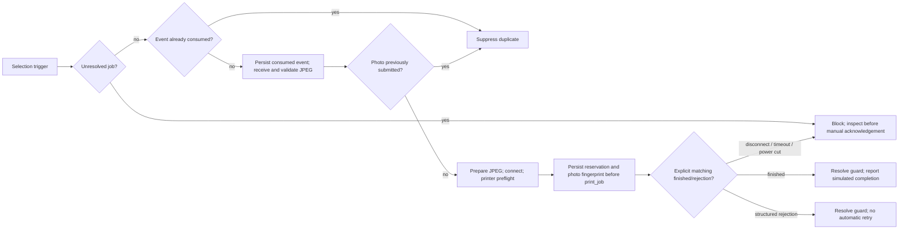

# MVP 4: headless bridge and portable Windows simulation

## Intent and scope

Implement Issue #6 on merged PR #4 (`d736caa`) while preserving the proven Android 0.2.2 camera-to-printer flow. The immediate deliverable is an offline Windows 10/11 x64 application image: an EXE launcher, its sidecar Java runtime and readable deterministic simulations. Development, tests and packaging run in Codex Cloud/GitHub Actions; the user compiles nothing. The user confirmed Windows x64 with WSL available; WSL is optional and is not used by this portable package.

The future target is an Orange Pi Zero 2W with 4 GB RAM, running a 64-bit Linux OS and Java 17. This PR delivers the reusable coordinator, protocol-level simulations and an architecture-independent Linux JVM distribution, with ARM64 CI where hosted runners permit it. Actual Linux Wi-Fi/Bluetooth adapters and autonomous physical printing remain a separate hardware milestone. Hardware mode must refuse to run rather than silently substitute simulation or claim radio support.

## Approaches considered

1. **Reuse Kotlin/JVM protocols with injected adapters (selected).** Existing `:sony` and `:printer` code retains its validated wire behavior; a new `:bridge` application owns orchestration, durable state and portable image preparation. Java ImageIO works on Windows/Linux with `java.desktop` included in the bundled runtime. This avoids another wire-protocol implementation and provides a direct path to Linux.
2. Rewrite in Python with platform Bluetooth libraries. Packaging might be smaller initially, but maintaining a second SOAP/framing/job implementation would discard the tested Kotlin baseline and introduce protocol drift.
3. Run Android in an emulator. This would not exercise a headless Linux coordinator, requires substantial local tooling and provides no evidence of the board's actual radios.

## Components and interfaces

- `:bridge` depends on `:sony` and `:printer`; Android depends on neither new bridge classes nor Java desktop libraries. A `headlessOnly` Gradle property excludes Android configuration for desktop CI, while default Android builds retain their existing modules.
- `SelectionTrigger(id: String)` is an opaque adapter-supplied selection-generation identifier, not a filename or camera identity. `CameraWifiConnector.connect(trigger): CameraLink` supplies a `CameraEndpoint`, existing `CameraTransport` and closure. A future Linux connector owns AP detection/rearming; the current connector simulates it without scanning or opening sockets.
- `PrintImagePreparer.validateSource(File)` is passed to `SonyTransferSession` so decoding succeeds before TransferEnd. `prepare(File, crop: Boolean): ByteArray` produces the printer JPEG without modifying the received original. `JvmPrintImagePreparer` uses bounded ImageIO subsampling, all eight EXIF orientation cases, existing `PrinterImageLayout` and `JpegHuffman.standardize`.
- `PrinterConnector.connect(): PrinterTransport` creates the injected transport. `PrintCoordinator.process(SelectionTrigger): BridgeResult` invokes the real Sony session, preparation and real printer session. Clock/pause injection keeps simulation time virtual. Safe diagnostics contain fixed stages, counts and enumerated outcomes, never arbitrary exception messages or configuration.
- `FileBridgeJournal` owns the existing `PrintJobGuard` contract and records consumed event hashes, attempted photo hashes and an unresolved reservation. A lifetime OS file lock excludes a second service instance. Its guard is valid only while the owning journal is open.
- `SimulatedSony` returns real descriptor/SCPD/SOAP/DIDL/selected JPEG responses, including nested action arguments and thumbnails. `SimulatedPrinter` parses actual encrypted request/file frames, checks job/upload constraints, reassembles the JPEG and returns fragmented version-1/type-6 replies, including an ignorable method notification. Neither device opens a real radio or network.

## State and duplicate prevention

This is conservative **at most one automatic submission**, not a claim of exactly-once physical output. An event is consumed before reception; a failure before printer reservation consumes that generation but permits another genuine generation to try the same photo. Once printer submission may have occurred, its photo fingerprint remains suppressed even if a finished/rejection response is followed by a process crash. The small deliberate cost is that a known rejected photo is not automatically resubmitted either. Intentional reprinting is outside this milestone.

Manual acknowledgement requires an explicit checked-printer flag and clears only the global uncertainty gate, retaining consumed events and attempted photo fingerprints. It never retries a job or cancels printer-side work. A fresh different photo can then proceed. Persisted corrupt/unsupported state fails closed. Fingerprints are local deduplication data, never shared diagnostics.

State updates write a checksummed bounded snapshot to a same-directory temporary file, force its contents, atomically replace the journal and sync directory metadata on supported POSIX filesystems. Windows uses a forced file and atomic replacement; physical power-loss/storage guarantees still require device testing. POSIX state directories/files use owner-only permissions; Windows state stays in the user's profile with inherited ACLs. No actual secrets are accepted by the simulation. Process restart, interrupted writes and concurrent instances are tested independently of physical hardware.

## Image preparation

Source bytes are bounded to 64 MiB. Image dimensions are inspected before decoding, and subsampling limits decoded dimensions to approximately 2048 pixels per axis. Output is RGB on white, **1040×1560**, FIT or centered CROP, baseline JPEG quality **0.90**, standard Annex K Huffman tables and at most **4 MiB**. EXIF rotation/mirroring precedes placement. Original bytes remain unchanged. Synthetic fixtures and independent decoding/DHT checks verify software preparation; Linux physical rendering is not claimed.

## CLI and deterministic scenarios

`--help`, `--simulate`, `--simulate-all`, `--simulate-failure=<name>`, `--state-dir=<directory>`, `--crop`, and `--acknowledge-checked-printer --confirm` are the supported controls. No arguments run the scenario suite and, when an interactive console exists, wait for Enter so Explorer users can read the result. Explicit commands never pause. `--hardware` exits with an unsupported-hardware category and opens no transports.

Scenarios cover normal operation, missing SSID, camera connection failure/timeout, empty selection, interrupted JPEG, printer offline, printer busy, dropped connection after submission, never-finished job, repeated triggers, repeated identical content on another trigger, restart suppression and manual recovery. Simulated timeouts advance virtual time instead of waiting minutes. A power-cut fault halts a separate CLI process after its durable reservation and simulated acceptance; CI starts another process on the same state and checks it blocks new jobs.

The ordinary simulation uses persistent state, so repeating the same default trigger is safely suppressed. The suite uses isolated synthetic scenario directories and asserts each expected result, including expected faults. It exits zero only if every check passes; individual failure experiments return nonzero, unknown outcomes have a separate code, and power-cut exits 71. Reports are bounded, redact paths/identity/payloads and identify **SIMULATION_ONLY / NO_PHYSICAL_PRINT**. Unexpected failures fail the suite. All tokens and photos are explicitly synthetic.

## Packaging and validation

GitHub Actions runs Sony/printer/bridge tests on Linux x64, Windows x64 and Linux ARM64. The existing Android workflow continues unchanged. Windows uses Java 17 `jlink`/`jpackage --type app-image --win-console` and packages the whole directory, not an allegedly standalone EXE. CI extracts the ZIP into a directory containing spaces, launches its EXE with PATH/JAVA_HOME unavailable, checks default and explicit scenarios, nonzero failure exits, crash/restart guarding and bundled-runtime use. It publishes a SHA-256 checksum, runtime licenses, test reports and safe smoke diagnostics.

Linux gets a JVM distribution requiring an installed architecture-matching Java 17 runtime; ARM64 CI executes that same distribution's simulation. Deployment docs provide a clearly inactive future systemd/configuration template and hardware checklist, not a working-radio claim.

## Future Orange Pi integration

Use NetworkManager with an owner/root-only saved Sony profile, explicit interface, no default internet route and a locally derived gateway. Do not put passwords in command arguments or logs. AP detection must track a stable sharing generation, wait for disappearance before rearming, debounce network flaps and retain content suppression across camera/bridge restarts. SOAP uses the existing HTTP transport with no redirects or system proxy and the selected camera route.

Use BlueZ Classic RFCOMM SPP, a known paired printer and an SDP-verified service channel. A Linux adapter/broker must implement bounded write/read/close and raw byte transport; neither BLE nor an assumed fixed channel is acceptable. Keep the user-owned token in a separate owner-only secret file or systemd credential, never in diagnostics or process arguments. Printer-offline/busy recovery may retry only before a submission reservation; accepted/uncertain jobs must not be replayed. Wi-Fi/Bluetooth coexistence, pairing, headless boot, rendering, restart/power-cut recovery and battery behavior all remain pending actual board testing.
